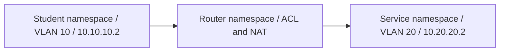

# Network and cloud laboratory

## Executable VLAN, routing, NAT and ACL exercise

network_lab.sh creates client, router and server network namespaces on a disposable Linux runner.
VLAN 10 and VLAN 20 subinterfaces travel across separate veth pairs. The router forwards between
them, applies default-deny iptables rules and translates the source with MASQUERADE. The client
must reach server port 8443, fail to reach 8080 and observe translated source 10.20.20.1.
Ports in this network test carry HTTP; a separate unit test demonstrates TLS certificate verification.
No rules are added to the user's laptop or the runner's root network namespace.

## Cloud mapping

The analogous cloud design uses public ingress, private application and database subnets,
restricted security groups, workload identity, a secrets manager, encrypted storage and centralized
audit logging. This is an architecture mapping, not a claim of an unrecorded cloud deployment.
A site-to-site VPN should authenticate endpoints and restrict inner routes; encryption does not
remove the need for ACLs. TLS here is application transport protection, not a site-to-site VPN.

## Defensive service examples

configs/services.conf documents DNS recursion restrictions, DHCP scope and SNMPv3 choices.
They are configuration examples requiring adaptation to the selected daemon, not live service logs.
OS checklist: non-admin application account, patching, filesystem permissions, audit retention,
recovery rehearsal and encrypted backups. Endpoint checks must be performed on owned lab systems.
No scanning of university networks is part of this repository.
